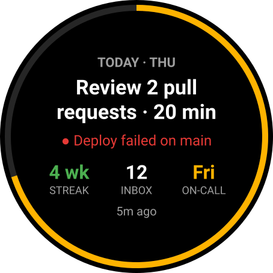
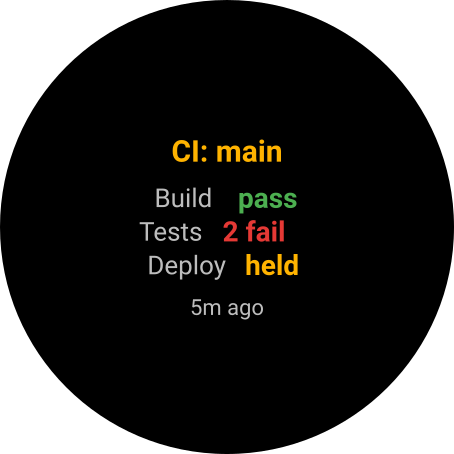
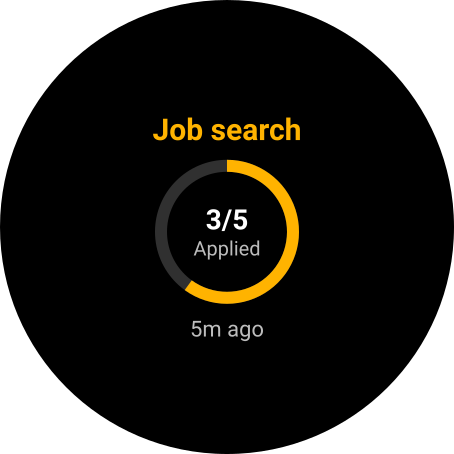
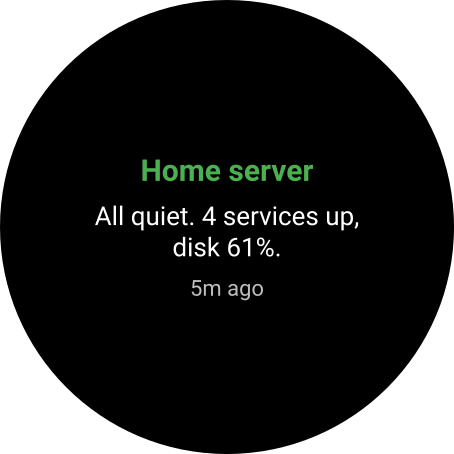
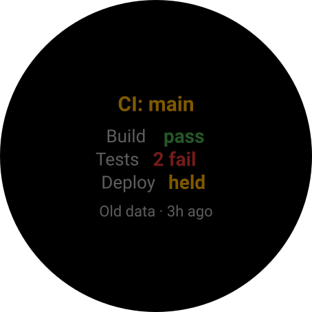
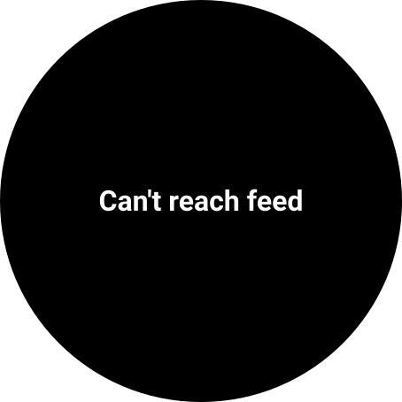
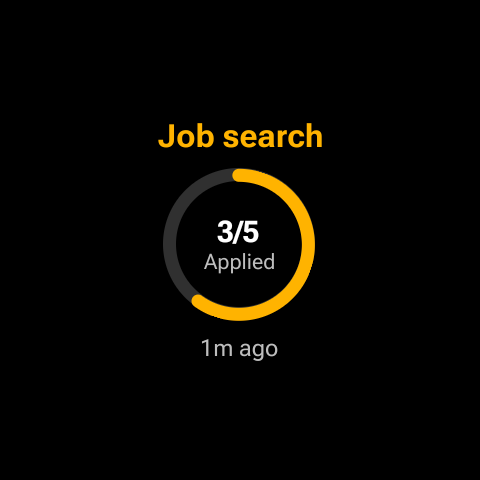
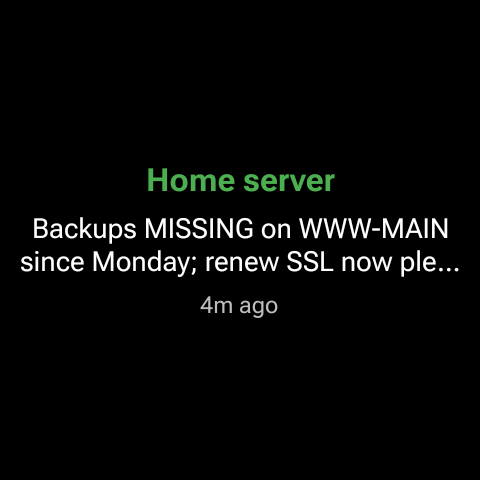
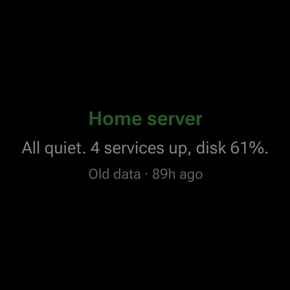

# WristFeed

**Put any feed on your wrist.**

[](https://github.com/Larmstrong1127/wristfeed/actions/workflows/publisher.yml)
[](https://github.com/Larmstrong1127/wristfeed/actions/workflows/android.yml)


> **Status: v0.1.** The feed format and the Python publisher are working. The Wear OS app builds and runs on a Galaxy Watch 8 (Wear OS, Android 16); first device run 2026-11-19.

WristFeed turns any JSON feed URL into a Wear OS tile and watch-face complications. You write a small JSON file from a script, a CI job or a server. You host it anywhere that serves HTTPS. The watch fetches it and shows it.

<p align="center">
  
  
  
  
  
  
</p>
<p align="center"><sub>Dashboard, stats, progress, message, stale (dimmed) and unreachable, rendered by <code>wristfeed preview</code> from <a href="examples/">examples/</a>.</sub></p>

<p align="center">
  
  
  
</p>
<p align="center"><sub>The same layouts on a real Galaxy Watch 8 (screenshots over <code>adb</code>, example feeds).</sub></p>

## Why

Most "one number on my wrist" apps are hard-wired to one data source. Smart-home dashboards are tied to their platform. Tile libraries still leave you to write the app. WristFeed is one app plus one small format, so anything that can write a file can reach your watch.

## How it works

```
 your script / CI job / server
            |
            |  wristfeed build ...   (Python CLI)
            v
   feed.json (SPEC v1)
            |
            |  wristfeed publish ... --gist ID   (or any static host)
            v
   HTTPS URL  (e.g. raw secret gist, GitHub Pages)
            |
            |  plain GET every 30 min, no auth
            v
   Wear OS app  ->  tile  +  SHORT_TEXT / LONG_TEXT / RANGED_VALUE complications
```

The watch fetches the URL itself. There is no phone app to pair.

## 60-second quickstart

1. Install the publisher and build a feed:

   ```sh
   pip install ./publisher
   wristfeed build --title "Deploys" --status ok \
     --row "Prod=green:ok" --row "Queue=3" \
     --stale-after 120 --out feed.json
   wristfeed validate feed.json
   ```

2. Host it. With the GitHub CLI, create a secret gist once, then update it:

   ```sh
   wristfeed publish feed.json --create              # once; prints the raw URL
   wristfeed publish feed.json --gist GIST_ID        # later updates
   ```

   Any HTTPS static host works too.

3. On the watch, open WristFeed, paste or type the raw URL, and add the tile.

## Preview your feed

No watch needed: render the tile as a round 454 px SVG, laid out like the Wear OS app.

```sh
wristfeed preview feed.json --out tile.svg
wristfeed preview feed.json --out stale.svg --now 2026-11-16T12:00:00Z   # pick the clock
wristfeed preview feed.json --out err.svg --state unreachable            # force a screen
```

`--state` takes `fresh`, `stale`, `unreachable`, `malformed`, `unsupported` or `loading`; `--size` changes the pixel size. The output has no timestamps, so it can be snapshot-tested.

## Feed format

The full contract is in [SPEC.md](SPEC.md). In short:

```json
{
  "wristfeed": 1,
  "title": "Deploys",
  "status": "ok",
  "kind": "stats",
  "rows": [{"label": "Prod", "value": "green", "status": "ok"}],
  "updated": "2026-11-16T06:40:00Z",
  "stale_after_minutes": 120
}
```

- Required: `wristfeed` (always `1`), `title`, `updated` (RFC 3339 UTC).
- `kind` picks the layout: `stats` (up to 3 rows), `progress` (a ring), `message` (one line), or
  `dashboard`: a ring around the screen edge, a two-line `headline`, an optional `alert` line and
  three chips (SPEC "Dashboard").
- `status` is `ok`, `warn`, `bad` or `idle` and colors the tile.
- Unknown fields are ignored. Bad optional fields fall back to defaults.
- The tile always shows one state: loading, fresh, stale, unreachable, malformed or unsupported. It never goes blank.

See [examples/](examples/) for three ready feeds and a scheduled GitHub Action.

## Security: feeds are public

**Do not put secrets in a feed.** A secret gist is unlisted, not private. Anyone with the URL can read it, and the watch fetches it without auth. Treat every feed as public data.

## Compared with prior art

| Project | Data source | Install | Layouts | License |
|---|---|---|---|---|
| **WristFeed** | Any JSON URL | Watch app only | Stats, progress ring, message; 3 complication types | MIT |
| [Wrist-Usage](https://github.com/Whyater/Wrist-Usage) | Claude/Codex usage limits via secret gist | Mac collector + phone app + watch app | Usage tile and complication | MIT |
| [compose-wear-tiles](https://github.com/halilozel1903/compose-wear-tiles) | Whatever you code | A library you build into your app | Stats, progress, message tiles | MIT |
| [Complications Suite](https://github.com/amoledwatchfaces/Complications-Suite-Wear-OS) | 42 built-in sources (custom text, goal, countdown, BTC) | Watch app | Complications | GPL-3.0 |
| [bambu-watch](https://github.com/Bocskay-Botond/bambu-watch) | A Bambu 3D printer | Phone + watch | Printer state tile | MIT |

Each of these does its own job well. Wrist-Usage in particular proved the gist-to-watch design that WristFeed generalizes. If a project already does what WristFeed does, please open an issue and tell us.

## Credits and prior art

- [Whyater/Wrist-Usage](https://github.com/Whyater/Wrist-Usage) (MIT): the secret-gist transport, the "unlisted, not private" warning, the clock-skew guard and the always-visible data age.
- [halilozel1903/compose-wear-tiles](https://github.com/halilozel1903/compose-wear-tiles) (MIT): the idea of a layout chosen by the data (stats, progress, message) and explicit error tiles.
- [amoledwatchfaces/Complications-Suite](https://github.com/amoledwatchfaces/Complications-Suite-Wear-OS) (GPL-3.0): ideas only for mapping data to complication types. No code was copied.
- [Bocskay-Botond/bambu-watch](https://github.com/Bocskay-Botond/bambu-watch) (MIT): a colored state enum for a tile.

## Repo layout

- `SPEC.md`: the feed format, version 1.
- `publisher/`: the `wristfeed` Python CLI (build, validate, publish).
- `android/`: the Wear OS app (Kotlin, ProtoLayout tiles, WorkManager refresh).
- `examples/`: sample feeds and a GitHub Action.

## Contributing

See [CONTRIBUTING.md](CONTRIBUTING.md). This project follows the [Contributor Covenant](CODE_OF_CONDUCT.md).

## License

[MIT](LICENSE). Built by [Landon Armstrong](https://larmstrong1127.github.io/).
